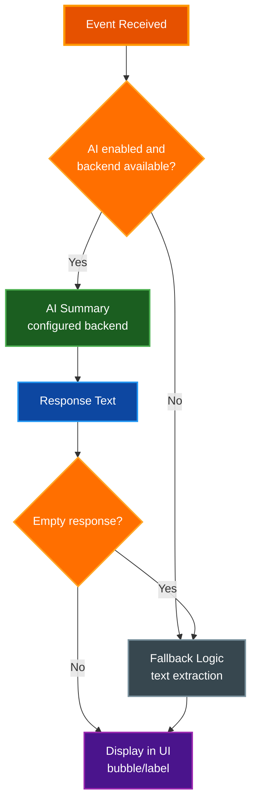

# AI Summary Service Documentation

This document describes the AI-powered summary system used in Claude Office Visualizer to generate concise descriptions for tool calls, agent tasks, and Claude responses.

## Overview

The `SummaryService` (`backend/app/core/summary_service.py`) provides AI-powered text summarization via a pluggable backend (`SUMMARY_BACKEND`: `claude-cli`, `openai`, or `disabled`; default `claude-cli`). When AI is unavailable, it falls back to simple text extraction methods. All handler references below are relative to `backend/app/core/handlers/`.

## Configuration

| Environment Variable | Purpose | Default |
|---------------------|---------|---------|
| `SUMMARY_BACKEND` | Summary backend: `claude-cli`, `openai`, or `disabled` | `claude-cli` |
| `SUMMARY_ENABLED` | Enable/disable summary service | `True` |
| `SUMMARY_MODEL` | Model used by the `claude-cli` backend | `claude-haiku-4-5-20251001` |
| `SUMMARY_MAX_TOKENS` | Max tokens for summary responses (`openai` backend only) | `1000` |
| `SUMMARY_CONCURRENCY` | Shared cap on in-flight summary calls | `4` |
| `SUMMARY_CLI_PATH` | `claude-cli` backend: CLI binary to invoke | `claude` |
| `SUMMARY_CLI_TIMEOUT` | `claude-cli` backend: subprocess timeout (seconds) | `15.0` |
| `SUMMARY_OPENAI_BASE_URL` | `openai` backend: endpoint base URL (e.g. `https://api.openai.com/v1`) | `""` |
| `SUMMARY_OPENAI_API_KEY` | `openai` backend: Bearer token (omitted from headers when empty) | `""` |
| `SUMMARY_OPENAI_MODEL` | `openai` backend: model (e.g. `gpt-4o-mini`) | `""` |
| `SUMMARY_OPENAI_TIMEOUT` | `openai` backend: request timeout (seconds) | `15.0` |

The `claude-cli` backend is active when the configured CLI is found on `PATH`; the `openai` backend is active only when both `SUMMARY_OPENAI_BASE_URL` and `SUMMARY_OPENAI_MODEL` are set. Otherwise the service disables AI and uses fallbacks.

## API Methods

### 1. `summarize_agent_task(task_description)`

Generates a short summary of a subagent's task.

**Prompt:**
```
In 10 words or less, summarize this task:
<data>{task_description}</data>
```

**Input Truncation:** 1000 characters max

**Fallback:** First sentence of description (max 50 chars)

**Called From:** `enrich_agent_with_summaries()` in `agent_handler.py` when a subagent spawns (also indirectly via `enrich_agent_from_transcript()` for ghost agents recovered after restart)

---

### 2. `summarize_user_prompt(prompt)`

Generates a summary of the user's prompt for display in the scrolling marquee.

**Prompt:**
```
In one sentence, summarize what this request asks for:
<data>{prompt}</data>
```

**Input Truncation:** 1500 characters max

**Short-circuit:** Returns original prompt if ≤120 chars and single sentence

**Fallback:** First sentence of prompt (max 150 chars)

**Called From:** `handle_user_prompt_submit()` in `conversation_handler.py` on `USER_PROMPT_SUBMIT` events

---

### 3. `generate_agent_name(description, existing_names=None, agent_type=None)`

Generates a fun, creative nickname for an agent based on its task. Deduplicates against already-assigned names.

**Prompt:**
```
Create a 1-3 word nickname that DIRECTLY relates to the task below. Extract the KEY ACTION or SUBJECT from the task and build the name around it. Examples: 'migrate YAML config' → YAML Yoda or Config King; 'write unit tests' → Test Pilot; 'fix database queries' → Query Queen; 'update documentation' → Doc Holiday; 'debug auth issue' → Bug Bounty. The name MUST reference the main subject (YAML, tests, database, docs, etc). Use puns, pop culture, or alliteration. Max 15 chars. Task: <data>{description}</data>
Names already taken (DO NOT use these): {existing_names}
Nickname:
```

**Parameters:**
- `description` — Task description used to generate the name (truncated to 500 chars)
- `existing_names` — `set[str] | None` of names already in use; passed to fallback and used for dedup

**Input Truncation:** 500 characters max

**Agent-type short-circuit:** If `agent_type` matches one of the curated slugs in the table below, the AI namer is skipped entirely and the fallback name is returned.

**Post-processing:**
1. Remove quotes, punctuation, and extra whitespace
2. Filter out single-character words
3. Reject responses with > 3 words or > 20 characters (use fallback instead)
4. Take at most 3 words
5. Enforce max 15 characters (truncate to fewer words if exceeds)
6. If result collides with `existing_names`, return fallback

**Fallback Logic (`generate_agent_name_fallback`):**
Generates fun, creative names by matching task keywords to themed name lists. First checks for exact `agent_type` matches, then falls through to keyword-based categories. All selections avoid names in `existing_names`.

**Agent Type Names (exact match on `agent_type`; a description that literally begins with a slug also matches):**

| Agent Type | Example Names |
|------------|---------------|
| general-purpose | The Intern, Helper Bot, Agent X, Minion |
| explore | Explorer X, The Scout, Data Digger, Researcher R |
| plan | The Planner, Strategy Sam, Blueprint Bob, Road Mapper |
| audit-architecture | The Architect, Refactor Rex, Code Ninja |
| audit-code-quality | The Critic, QA Queen, Inspector G |
| audit-security | Security Sam, Guard Dog, Sec Spec |
| audit-documentation | The Scribe, Doc Brown, Word Wizard |
| fix-architecture | The Architect, Refactor Rex, Code Ninja |
| fix-code-quality | Bug Squasher, Mr. Fixit, The Fixer |
| fix-security | Lock Smith, Guard Dog, Security Sam |
| fix-documentation | Doc Brown, The Scribe, Note Taker |
| markdown-docs-writer | The Scribe, Doc Brown, Word Wizard |
| webgl-shader-expert | Pixel Pete, Shader Sam, GPU Guru |

**Keyword-Based Categories:**

| Task Category | Keywords | Example Names |
|---------------|----------|---------------|
| Review/QA | review, audit, inspect, qa, quality | Judge Judy, The Critic, Hawkeye, Inspector G, The Auditor |
| Testing | test, spec, assert, expect | Test Pilot, Dr. Test, QA Queen, Bug Buster, Test Dummy |
| Validation | validate, verify, check, ensure | The Checker, Validator V, Fact Checker, Truth Seeker |
| Cleaning | clean, cleanup, tidy, organize | The Cleaner, Mr. Clean, Tidy Bot, Neat Freak |
| Formatting | format, prettier, lint, style | Style Guru, Format King, Lint Lord, Pretty Boy |
| Refactoring | refactor, restructure, reorganize | The Architect, Refactor Rex, Code Ninja, Dr. Refactor |
| Debugging | debug, diagnose, troubleshoot | Bug Hunter, Dr. Debug, Sherlock, The Debugger |
| Fixing | fix, repair, patch, resolve | The Fixer, Patch Adams, Mr. Fixit, Bug Squasher |
| Documentation | doc, document, readme, comment | The Scribe, Doc Brown, Word Wizard, Note Taker |
| Writing | write, create, draft, compose | The Writer, Wordsmith, Pen Pal, Script Kid |
| Research | research, investigate, explore, analyze | The Scout, Explorer X, Data Digger, Researcher R |
| Search | search, find, locate, discover | The Seeker, Finder Fred, Search Bot, Tracker T |
| Building | build, implement, create, develop | The Builder, Code Monkey, Dev Dawg, Maker Mike |
| Setup | setup, configure, install, init | Setup Sam, Config Kid, Init Ian, Boot Boss |
| Type checking | type, typecheck, typing, pyright, mypy | Type Tyrant, Type Cop, Type Ninja, Mr. Strict |
| Migration | migrate, upgrade, update, convert | The Migrator, Upgrade Ulysses, Version Vic, Update Ursula |
| Performance | optimize, performance, speed, fast | Speed Demon, Turbo T, Optimizer O, Fast Freddy |
| Security | security, secure, vulnerability, auth | Security Sam, Guard Dog, Sec Spec, Lock Smith |
| Database | database, sql, query, migration | Data Dan, SQL Sally, Query Queen, DB Dude |
| API/Backend | api, endpoint, route, backend | API Andy, Route Runner, Backend Bob, Endpoint Ed |
| Frontend/UI | frontend, ui, component, react, css | UI Ursula, Pixel Pete, Front Fred, Style Steve |
| Generic | (no match) | Code Cadet, Bit Buddy, Logic Larry, Algo Al, Helper Bot, Task Force, Agent X, The Intern, Worker Bee, Minion |

Names are randomly selected from each category, excluding those in `existing_names`. If all names in a category are taken, `dedupe_name()` appends a numeric suffix (e.g. "The Intern 2").

**Called From:**
- `enrich_agent_with_summaries()` in `agent_handler.py` when a subagent spawns
- `_create_agent()` in `backend/app/core/state_machine.py` uses `generate_agent_name_fallback` directly for immediate short name generation

---

### 4. `summarize_response(response_text)`

Generates a short summary of Claude's response for speech bubbles.

**Prompt:**
```
In 15 words or less, summarize this response:
<data>{response_text}</data>
```

**Input Truncation:** 2000 characters max

**Fallback:** First sentence of response (max 100 chars)

**Called From:**
- `extract_and_set_boss_speech()` in `conversation_handler.py` — Boss speech bubble when session stops
- `extract_and_set_agent_speech()` in `agent_handler.py` — Agent speech bubble when subagent stops

---

### 5. `detect_report_request(prompt)`

Detects if the user's prompt requests a report or document to be created.

**Prompt:**
```
Does this request ask for a report, document, or documentation to be created? Reply with ONLY 'yes' or 'no':
<data>{prompt}</data>
```

**Input Truncation:** 1000 characters max

**Fallback Logic:**
- Keyword search for: report, document, documentation, readme, write up, writeup, summary report, create a doc, generate a doc, write a doc, pdf, markdown file, md file, .md, architecture, changelog, contributing, license, guide
- Pattern matching for: "create/write/generate/update/add ... .md"

**Called From:** `detect_and_set_print_report()` in `conversation_handler.py` on `STOP` events

---

## API Call Details

### Model Configuration
- **Model:** The `claude-cli` backend uses `SUMMARY_MODEL`; the `openai` backend uses `SUMMARY_OPENAI_MODEL`
- **Max Tokens:** `SUMMARY_MAX_TOKENS` (default: 1000) applies to the `openai` backend only; the CLI backend imposes no token cap
- **Retries:** 1 retry on failure, then fallback

### Prompt Framing
Every request is sent with a shared system prompt that frames the summarizer's task and treats text between `<data>`/`</data>` tags as untrusted data (prompt-injection hardening). Any pre-existing `<data>`/`</data>` tags in user content are stripped before a prompt is built.

### Authentication
Authentication depends on the backend:
- `claude-cli` (default): subprocess calls to the `claude` CLI authenticate via the user's logged-in Claude subscription — no token required.
- `openai`: sends `SUMMARY_OPENAI_API_KEY` as a Bearer token when set; the header is omitted when empty (keyless local servers such as Ollama or LM Studio).

### Console Output
When summaries are enabled, the service logs a banner at startup. With the default `claude-cli` backend:
```
==================================================
AI SUMMARIES ENABLED (claude-cli backend)
  CLI: claude  Model: claude-haiku-4-5-20251001
==================================================
```
With the `openai` backend:
```
==================================================
AI SUMMARIES ENABLED (openai-compatible backend)
  Base URL: https://api.openai.com/v1
  Model: gpt-4o-mini
==================================================
```

### Error Handling
The service gracefully falls back to text extraction when:
- backend call fails (after 1 retry)
- AI returns an empty response
- AI response has no content

```python
async def _call_with_retry(self, prompt: str, max_retries: int = 1) -> str | None:
    """Call the configured backend with retry on error, returning None on failure."""
    if not self.enabled:
        return None

    runner = self._run_openai if self._backend == "openai" else self._run_cli

    for attempt in range(max_retries + 1):
        try:
            return await runner(prompt)
        except Exception as e:
            detail = f"{type(e).__name__}: {e}"
            if attempt < max_retries:
                logger.warning(f"Summary backend error, retrying: {detail}")
            else:
                logger.debug(f"Summary backend failed after retry, using fallback: {detail}")
                return None

    return None
```

---

## Helper Methods

### Path Utilities (in `path_utils.py`)

#### `compress_path(path, max_len=35)`
Compresses file paths for display:
1. Replace home directory with `~`
2. If still too long, truncate from BEGINNING (preserves filename)
3. Prepend `...` to truncated paths

#### `compress_paths_in_text(text)`
Replaces all occurrences of home directory with `~` in any text.

#### `truncate_long_words(text, max_len=30)`
Truncates individual words that are too long, preserving the rest of the text.

### Summary Service Methods

#### `_extract_first_sentence(text, max_len=100)`
Extracts first sentence for fallback summaries:
1. Find first `.`, `!`, or `?` after at least 10 characters
2. If no sentence end found, truncate at max_len with `...`

---

## Usage Flow



---

## Related Documentation

- [Architecture](../architecture/ARCHITECTURE.md) - System design and component overview
- [PRD](../../PRD.md) - Full product requirements including AI summary integration (historical snapshot)
